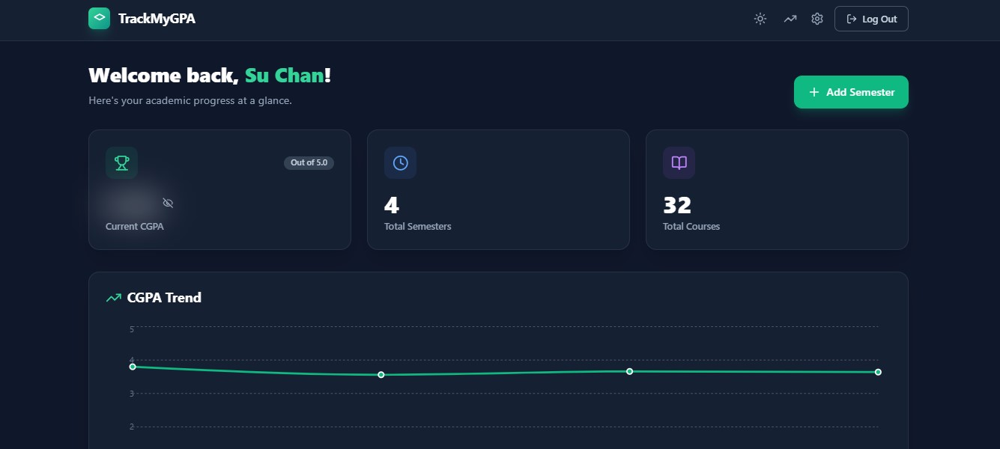
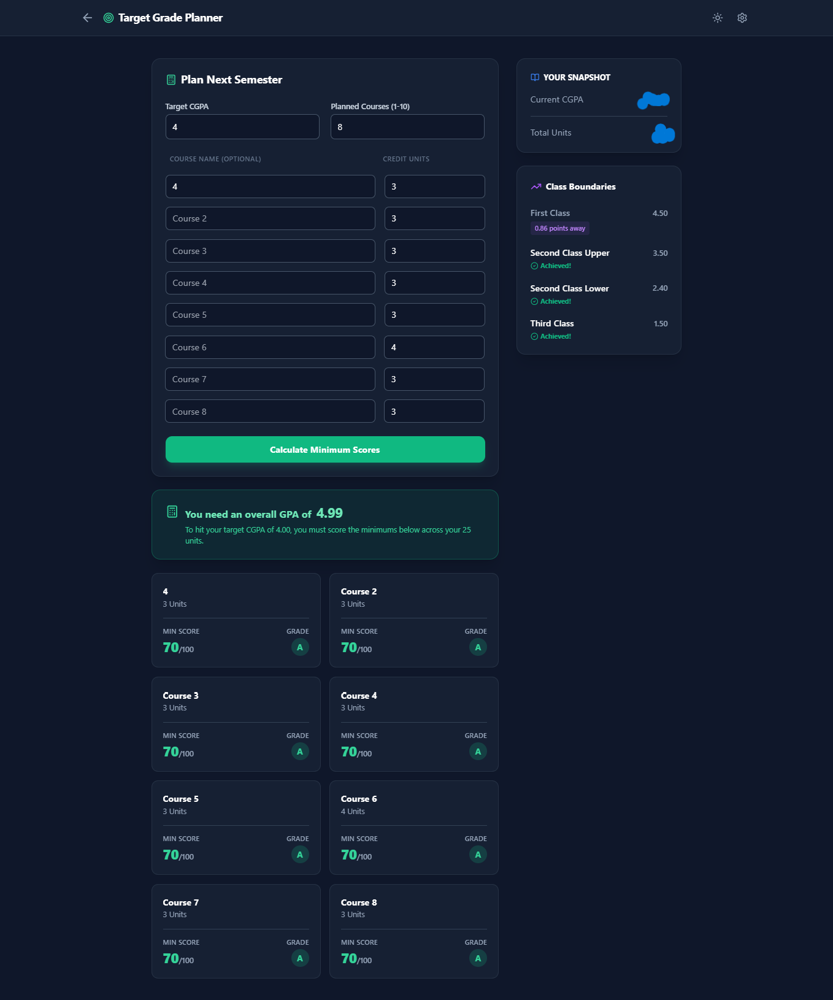
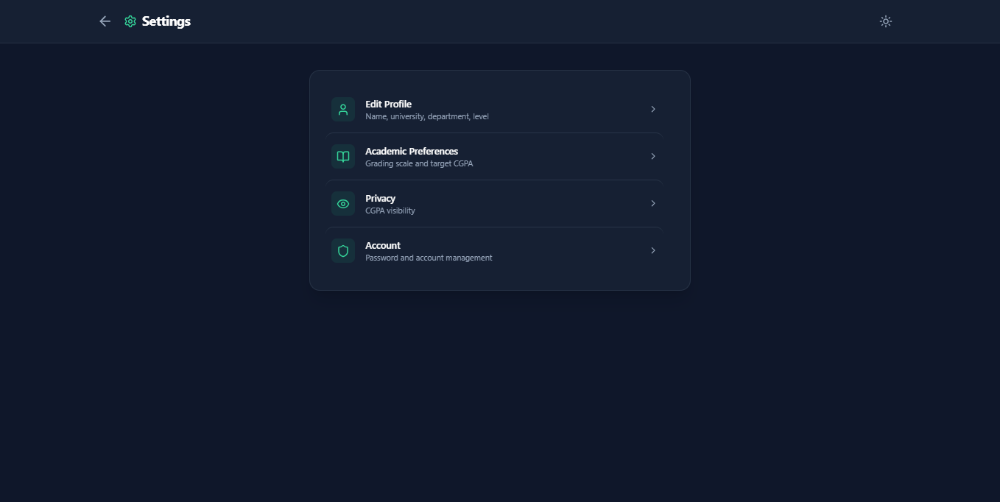
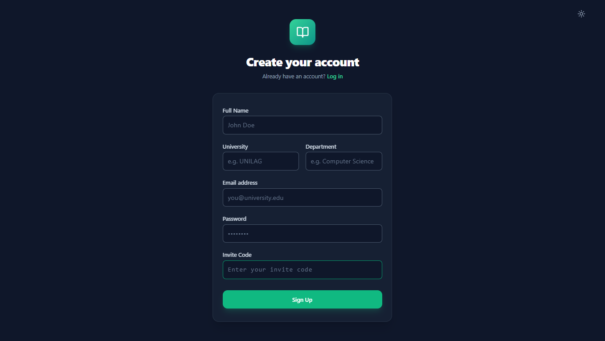

# TrackMyGPA — Student Performance Tracker

TrackMyGPA is a web app for organizing semesters and courses, calculating semester GPA and cumulative CGPA, and watching academic performance trend over time — plus a planner that estimates the grades needed to hit a target CGPA.

It is built with React + Vite on the frontend and Supabase (Auth + PostgreSQL) on the backend, styled with Tailwind CSS.

> This is the public portfolio version of the project. It ships with the full frontend and a reproducible backend setup, but **you must connect your own Supabase project** — no database or credentials are included here.

## Why I built it

I wanted a convenient way to organize semesters and courses in one place, calculate GPA and CGPA without spreadsheets, and track academic performance over time instead of guessing where I stood. Most tools I tried were either generic grade calculators with no memory of past semesters, or full school portals I couldn't control. So I built my own: semesters hold courses, courses carry scores and credit units, and the dashboard turns all of that into a CGPA, a trend chart, and a target planner. This repository is that project, cleaned up so someone else can read the code and run their own instance.

## Why this repository is public

The original working repository for this project remains private. This public copy exists to:

- Showcase the implementation and technical decisions
- Make the source code inspectable by recruiters and other developers
- Let others learn from it and set up their own instance
- Document the required backend setup instead of assuming access to my private infrastructure

It is the same app, not a rewrite or a separate product — just decoupled from my private backend. Anything referencing my personal infrastructure, credentials, or internal development details has been removed.

## Features

Everything below is verified in the source code (`src/`):

- **Authentication and user profiles** — Email/password sign-up and sign-in via Supabase Auth, session restoration on reload, protected routes, and a profile row (`profiles`) created at signup with full name, university, and department.
- **Invite-code registration** — Signup requires an invite code, verified and redeemed through the `check_invite_code` / `redeem_invite_code` RPCs. (Note: this public copy documents the RPC contracts but does not ship the original code table — see [Supabase backend setup](supabase/README.md). Until you implement those two functions, signup rejects every code.)
- **Semester management** — Add semesters with level (`100L`–`600L`), semester (`First`/`Second`), and academic year; view each semester's GPA and its courses on a detail page.
- **Course management** — Add courses with code, name, credit units, score (0–100), and a carry-over flag. Grades and grade points are derived locally. Courses can be edited inline one final time (the `edited` flag hides the Edit button afterwards — a UI convention, not a database constraint).
- **GPA and CGPA calculations** — Weighted GPA math in `src/lib/gpa.js`, supporting the **Nigerian 5.0 scale** (default) and the **international 4.0 scale**, switchable per user in settings.
- **CGPA trend visualization** — Dashboard line chart (Recharts) showing cumulative CGPA across semesters, plus per-semester GPA cards with change vs. the previous semester and a warning banner when CGPA drops below target.
- **Target grade planner (`/simulator`)** — Enter a target CGPA and 1–10 planned courses with credit units; it computes the required GPA, an estimated minimum score/grade per course, and shows Nigerian class boundaries (First Class 4.50, Second Class Upper 3.50, Second Class Lower 2.40, Third Class 1.50).
- **Theme and privacy/display preferences** — Dark/light mode (persisted in `localStorage`) and an optional CGPA blur: blur-on-load is stored on the profile, instant blur/unblur is per-device.
- **Settings hub** — Edit profile, academic preferences (grading scale, target CGPA), privacy toggles, password change (min 8 characters), and account deletion via the `delete_user()` RPC followed by sign-out.

## Screenshots



*Dashboard in dark mode: current CGPA (blurred for privacy), totals, and the cumulative trend across semesters.*



*Simulator with 8 planned courses: required overall GPA, minimum score/grade per course, and Nigerian class-boundary progress (snapshot figures redacted).*



*Settings hub linking to Edit Profile, Academic Preferences, Privacy, and Account management.*



*Account creation form (placeholder data shown): name, university, department, credentials, and the required invite code.*

A semester-detail screenshot is not included yet — a capture of a semester page with its GPA summary and course cards would round out the set.

## Tech stack

Verified from `package.json`, configs, and source imports:

| Layer | Technology |
| --- | --- |
| UI | React 19 + React DOM |
| Build / dev server | Vite 8 |
| Routing | React Router DOM 7 (SPA fallback configured in `vercel.json`) |
| Backend | Supabase: Auth (email/password) + PostgreSQL via `@supabase/supabase-js` v2 |
| Styling | Tailwind CSS 3 + PostCSS + Autoprefixer |
| Charts | Recharts (CGPA trend) |
| Icons | Lucide React |
| Lint | ESLint 9 (`react-hooks`, `react-refresh`) |

Package manager: **npm** — `package-lock.json` is committed, so use `npm ci` for a reproducible install.

## Architecture

The app is a client-rendered SPA. The React frontend talks directly to Supabase: Auth for identity, PostgREST for table reads/writes, and RPC for the invite-code and account-deletion flows. Authorization lives in the database, not the frontend — every table has owner-only Row Level Security policies keyed on `auth.uid()`, and the one privileged operation (deleting the `auth.users` row) runs inside a narrowly scoped `SECURITY DEFINER` function. Grade math and the simulator are pure client-side functions; the database stores scores, grades, and points as calculated at write time.

```mermaid
flowchart TB
    Browser[React SPA<br/>pages / context / lib] --> Auth[Supabase Auth<br/>email+password<br/>sessions]
    Browser -->|PostgREST<br/>owner-only RLS| Profiles[(profiles<br/>1 row per user)]
    Browser -->|PostgREST<br/>owner-only RLS| Semesters[(semesters<br/>user_id)]
    Browser -->|PostgREST<br/>owner-only RLS| Courses[(courses<br/>user_id + semester_id)]
    Browser -->|rpc check/redeem<br/>not shipped: owner implements| Invite[Invite-code RPCs<br/>contract documented]
    Browser -->|rpc delete_user()<br/>SECURITY DEFINER<br/>auth.uid() only| DelAcct[Deletes own rows<br/>+ auth.users row]
    GPA[src/lib/gpa.js<br/>5.0 / 4.0 scales] -.-> Browser
```

Table relationships: `profiles.id` **is** the auth user id; `semesters.user_id` and `courses.user_id` reference `auth.users(id)`; `courses.semester_id` references `semesters(id)` with cascade delete. Full DDL, indexes, and policies live in `supabase/schema.sql`; the function in `supabase/functions.sql`; the walkthrough in `supabase/README.md`.

## Prerequisites

- Node.js LTS (20+ recommended for Vite 8) and npm — verify with `node -v` and `npm -v`.
- A Supabase account (free tier works) — you will create a **new, empty** project; nothing connects to mine.
- Git, to clone the repository.

## Complete installation guide

1. **Clone this public repository:**
   ```bash
   git clone https://github.com/ChuKuangren97/trackmygpa-public
   cd trackmygpa-public
   ```
2. **Install dependencies** with the committed lockfile:
   ```bash
   npm ci
   ```
   (`npm install` also works; `npm ci` is the exact-lockfile variant.)
3. **Create a new Supabase project** in your own account (free tier is fine) and wait for provisioning.
4. **Apply the included SQL in order** in the Supabase **SQL Editor**, as the project owner:
   - First `supabase/schema.sql` (tables, indexes, RLS policies).
   - Then `supabase/functions.sql` (the `delete_user()` function + invite-code contracts).
   - Confirm the `profiles`, `semesters`, and `courses` tables exist and are empty.
   - Details and rationale: [supabase/README.md](supabase/README.md).
5. **Configure authentication:** enable the Email provider; keep **Confirm email OFF** (the signup flow inserts the profile and redeems the invite code immediately after `signUp()`, which requires a live session); add your dev URL (usually `http://localhost:5173`) under URL Configuration.
6. **Provision invite codes:** this copy ships no invite-code table by design, so implement `check_invite_code(input_code)` and `redeem_invite_code(input_code)` per the contracts in `supabase/functions.sql` / `supabase/README.md`, then create your own codes. Until then, every signup is rejected with “Invalid or already used invite code” — expected, not a bug.
7. **Create a local `.env` file** from the template:
   ```bash
   cp .env.example .env
   ```
   On Windows (PowerShell): `Copy-Item .env.example .env`.
8. **Set the Supabase URL and publishable/anon key:** from your project's **Settings > API**, copy the Project URL into `VITE_SUPABASE_URL` and the publishable/anon key into `VITE_SUPABASE_ANON_KEY`. Never put a service-role key in the frontend.
9. **Start the development server:**
   ```bash
   npm run dev
   ```
   Open the printed URL (usually `http://localhost:5173`). Sign up with one of your own invite codes, add a semester and a few courses, and confirm the dashboard and simulator update.
10. **Troubleshooting common setup failures:**
    - Signup always rejected → invite RPCs not implemented yet (step 6).
    - Profile insert/redeem fails right after signup → email confirmation is on (step 5).
    - “Semester not found” for an existing semester → RLS isolation: it belongs to another user.
    - Blank app / Supabase network errors → wrong `.env` values; restart the dev server after editing `.env`.
    - Full table: [supabase/README.md](supabase/README.md#8-troubleshooting).

A fresh backend contains no semesters or courses — each developer starts empty and owns their own configuration. Other useful scripts: `npm run build` (production build to `dist/`), `npm run preview` (serve the build), `npm run lint` (ESLint).

## Environment variables

| Variable | Purpose | Where used |
| --- | --- | --- |
| `VITE_SUPABASE_URL` | Your Supabase project URL (`https://<ref>.supabase.co`) | `src/lib/supabase.js` |
| `VITE_SUPABASE_ANON_KEY` | Your project's publishable/anon key (safe for browsers **only because** RLS enforces access) | `src/lib/supabase.js` |

These are the only two variables the app reads. `.env.example` contains placeholders and is safe to commit; `.env` (real values) is git-ignored and must never be committed.

## Database and security notes

- **RLS is the access control.** All three tables have owner-only `SELECT`/`INSERT`/`UPDATE`/`DELETE` policies on `auth.uid() = id` (profiles) or `auth.uid() = user_id` (semesters, courses). The frontend's `.eq('user_id', …)` filters are convenience, not protection — notably, the course update filters by row id only, so RLS is what stops cross-user edits.
- **Invite codes:** no table ships here; whatever you build must deny direct table access to `anon`/`authenticated` and expose only the two RPCs (`check` to anon+authenticated, `redeem` to authenticated only), with redemption as one atomic conditional update.
- **Account deletion:** `delete_user()` takes no arguments and deletes only the caller's rows plus their `auth.users` entry. It is `SECURITY DEFINER` with a fixed `search_path`, null-`auth.uid()` rejection, no dynamic SQL, and `EXECUTE` granted to `authenticated` only. If your project blocks the `auth.users` delete, remove the user via Dashboard > Authentication > Users instead.
- **Dev vs. production:** this setup is a solid local-development baseline, not a production audit. Before any real deployment, re-verify policies with two test users (including direct API calls outside the UI), review the invite implementation for race abuse, decide on email confirmation vs. a post-login redeem flow, and set up backups.
- **Known limitation:** `courses.semester_id` is client-supplied and RLS checks `user_id` only — a user could link their own course to someone else's semester id (invisible in the app's doubly-filtered queries, but not trigger-checked). Documented in `supabase/schema.sql`.

## Project limitations and future improvements

Current boundaries (not bugs, just scope): no semester/course deletion UI, no course delete endpoint usage, single-edit courses by UI convention, simulator assumes the 5.0 scale for minimum-score estimates, no offline mode, no automated tests in the repo.

Potential future work — none of this is implemented, listed here as ideas only:

- Semester/course deletion with confirmation and cascade review.
- Backend-enforced single-edit rule (currently risky for retries, so deliberately left frontend-only).
- Email-confirmation-compatible signup (redeem after first sign-in).
- 4.0-scale-aware simulator estimates.
- Unit tests for `src/lib/gpa.js` and integration tests for the Supabase setup.
- CI (lint + build) and additional screenshots (e.g. semester detail, light mode).

## Contributing

Issues and pull requests are welcome: open an issue describing the problem or proposal (include steps to reproduce and your Supabase/Node versions where relevant), keep changes narrow and consistent with the existing code style, and never include credentials, dumps, or real user data. For backend changes, update `supabase/*.sql` and the corresponding docs together.

## License

This project is released under the MIT License — see [LICENSE](LICENSE) for the full text.

Note: the license covers this project's own source code and documentation. Third-party dependencies (listed under [Tech stack](#tech-stack)) and external services such as Supabase remain under their own respective licenses and terms.
